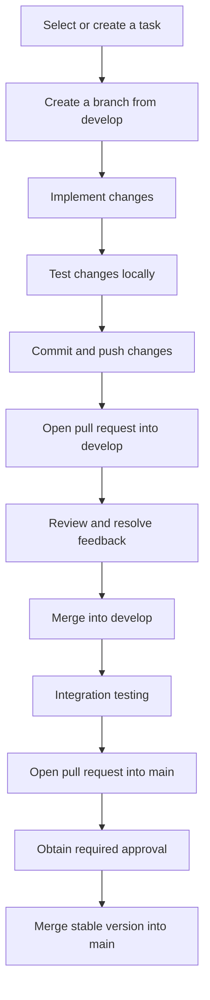

# Contributing to Nosh Nosh

Thank you for contributing to Nosh Nosh!

This document outlines the development workflow, branching strategy, coding conventions and collaboration practices used throughout the project. Its purpose is to ensure consistent, organised and reliable development across the team.

All contributors are encouraged to follow these guidelines and suggest improvements as the project evolves.

## Table of Contents

- [Development Workflow](#development-workflow)
- [Branching Strategy](#branching-strategy)
- [Branch Protection](#branch-protection)
- [Getting Started](#getting-started)
- [Working on a Task](#working-on-a-task)
- [Commit Conventions](#commit-conventions)
- [Pull Requests](#pull-requests)
- [Code Reviews](#code-reviews)
- [Merge Strategy](#merge-strategy)
- [Merge Conflicts](#merge-conflicts)
- [Issues and Task Management](#issues-and-task-management)
- [Coding Standards](#coding-standards)
- [Testing and Quality Assurance](#testing-and-quality-assurance)
- [Security and Privacy](#security-and-privacy)
- [Documentation](#documentation)
- [Team Collaboration](#team-collaboration)
- [Future Improvements](#future-improvements)

## Development Workflow

Nosh Nosh follows a simplified Git Flow approach, separating stable application versions from ongoing development and individual feature implementation.



## Branching Strategy

### Permanent Branches

| Branch | Purpose |
| --- | --- |
| `main` | Stable, tested and demonstrable versions of the application. |
| `develop` | Ongoing development, feature integration and testing. |

Both permanent branches are protected. Changes must be introduced through pull requests.

### Temporary Branches

Temporary branches should normally be created from `develop` and deleted after their changes have been successfully merged.

| Prefix | Purpose | Example |
| --- | --- | --- |
| `feature/` | New functionality | `feature/ingredient-selection` |
| `fix/` | Bug fixes | `fix/recipe-search` |
| `docs/` | Documentation changes | `docs/contribution-guide` |
| `refactor/` | Code restructuring | `refactor/recipe-matching` |
| `test/` | Testing improvements | `test/ingredient-matching` |
| `chore/` | Maintenance and configuration | `chore/project-setup` |

### Branch Naming Conventions

- Use lowercase letters.
- Separate words with hyphens.
- Use a descriptive prefix.
- Keep names concise and meaningful.
- Avoid personal names and unclear descriptions.

Good examples:

- `feature/recipe-details`
- `feature/nutritional-filters`
- `fix/ingredient-search`
- `docs/setup-instructions`

Avoid names such as:

- `my-branch`
- `new-stuff`
- `test123`
- `final-version`

## Branch Protection

The project uses GitHub repository rulesets to protect its permanent branches.

| Protection rule | `main` | `develop` |
| --- | --- | --- |
| Pull requests required | Yes | Yes |
| Required approvals | 1 | 0 |
| Branch deletion restricted | Yes | Yes |
| Force pushes blocked | Yes | Yes |
| Conversation resolution required | Yes | Yes |
| Stale approvals dismissed | Yes | No |
| Automated status checks | Planned | Planned |

### Important Rules

- Do not push changes directly to `main` or `develop`.
- Do not attempt to force push to permanent branches.
- Do not delete permanent branches.
- Use pull requests to introduce changes.
- Only merge stable and tested versions into `main`.

Although approvals are not currently mandatory for `develop`, peer reviews are strongly encouraged.

## Getting Started

### Prerequisites

- A GitHub account.
- Git installed locally.
- Access to the project repository.
- A suitable code editor or development environment.

Additional software requirements will be documented once the technology stack has been confirmed.

### Clone the Repository

```bash
git clone https://github.com/ArtemShkurat/Launchpad-Cooking-App.git
cd Launchpad-Cooking-App
```

### Switch to the Development Branch

```bash
git switch develop
git pull origin develop
```

## Working on a Task

### 1. Select a Task

Choose an existing GitHub Issue or discuss a new task with the team.

Before starting, ensure that another contributor is not already working on the same task.

### 2. Update Your Local Development Branch

```bash
git switch develop
git pull origin develop
```

### 3. Create a Temporary Branch

For example:

```bash
git switch -c feature/ingredient-selection
```

### 4. Implement and Test Changes

Develop the required functionality and test it locally before submitting changes.

Keep each branch focused on a specific task.

### 5. Review Your Changes

```bash
git status
git diff
```

### 6. Stage and Commit Changes

Stage the relevant files:

```bash
git add <file-path>
```

Review the staged changes:

```bash
git diff --staged
```

Create a descriptive commit:

```bash
git commit -m "feat: add ingredient selection"
```

### 7. Push Your Branch

```bash
git push -u origin feature/ingredient-selection
```

### 8. Create a Pull Request

Open GitHub and create a pull request with:

- Base branch: `develop`
- Compare branch: your temporary branch

Describe the changes, explain how they were tested and reference the associated issue where applicable.

## Commit Conventions

The project follows the Conventional Commits approach.

### Commit Format

```text
<type>: <short description>
```

An optional scope may also be included:

```text
<type>(<scope>): <short description>
```

### Commit Types

| Type | Purpose |
| --- | --- |
| `feat` | Introduce new functionality |
| `fix` | Resolve a bug |
| `docs` | Update documentation |
| `style` | Formatting changes that do not affect behaviour |
| `refactor` | Restructure existing code without changing behaviour |
| `test` | Add or update tests |
| `perf` | Improve performance |
| `build` | Modify build configuration or dependencies |
| `ci` | Update continuous integration workflows |
| `chore` | General maintenance |
| `revert` | Revert previous changes |

### Examples

```text
feat: add ingredient selection screen
feat(recipes): implement recipe matching
fix: resolve ingredient search issue
docs: update project README
refactor: simplify recipe matching logic
test: add ingredient matching tests
chore: configure development environment
ci: add automated build workflow
```

### Commit Guidelines

- Use clear and descriptive messages.
- Keep commits focused on a specific change.
- Avoid committing unrelated changes together.
- Use the imperative form, such as "add", "fix" or "update".
- Avoid vague messages such as "changes", "stuff" or "final update".

## Pull Requests

All changes to permanent branches must be introduced through pull requests.

### Pull Request Guidelines

- Use a clear and descriptive title.
- Explain what has changed and why.
- Reference related GitHub Issues.
- Describe how the changes were tested.
- Include screenshots for significant interface changes where appropriate.
- Keep pull requests focused and reasonably sized.
- Resolve review comments before merging.

### Pull Request Template

```markdown
## Summary

Briefly describe the purpose of this pull request.

## Changes

- Describe the main changes.
- Include relevant implementation details.

## Testing

Explain how the changes were tested.

## Related Issues

Closes #issue-number

## Screenshots

Include screenshots where applicable.

## Checklist

- [ ] Changes have been tested locally.
- [ ] Code follows the project guidelines.
- [ ] No sensitive information has been committed.
- [ ] Relevant documentation has been updated.
- [ ] Changes are ready for review.
```

Replace the issue placeholder with an actual issue number, or remove the reference if no issue exists.

## Code Reviews

Code reviews help improve software quality, maintain consistency and share knowledge across the team.

When reviewing a pull request, consider:

- Correctness and functionality.
- Code readability and maintainability.
- Potential bugs and edge cases.
- Security and privacy concerns.
- Performance and unnecessary complexity.
- Testing coverage.
- Compliance with project requirements.

Feedback should be constructive, respectful and focused on the code rather than the contributor.

At least one eligible contributor must approve a pull request before it can be merged into `main`.

## Merge Strategy

The following merge methods are recommended.

| Source | Destination | Recommended method |
| --- | --- | --- |
| Temporary branch | `develop` | Squash and merge |
| `develop` | `main` | Create a merge commit |

Squash merging keeps the development history concise by combining related commits into a single commit.

Merge commits preserve the relationship between the permanent branches when publishing stable application versions.

Temporary branches should normally be deleted after merging.

The `main` and `develop` branches must not be deleted.

## Merge Conflicts

Merge conflicts can occur when multiple contributors modify the same files.

To incorporate the latest development changes into your temporary branch:

```bash
git fetch origin
git merge origin/develop
```

Run these commands while on your temporary branch.

If conflicts occur:

1. Identify the conflicting files using `git status`.
2. Review the conflicting changes.
3. Resolve the conflicts carefully.
4. Discuss unclear changes with the relevant contributor.
5. Stage the resolved files.
6. Complete the merge commit.
7. Test the application again.
8. Push the updated branch.

Do not overwrite another contributor's work without understanding the changes.

## Issues and Task Management

GitHub Issues will be used to organise development tasks, feature requests, bugs and technical improvements.

Each issue should include:

- A descriptive title.
- A clear explanation of the task or problem.
- Relevant requirements.
- Acceptance criteria where appropriate.
- Priority and relevant labels.
- An assigned contributor when applicable.

The team should keep task statuses up to date and communicate any blockers.

GitHub Projects may be used to visualise and manage development progress.

## Coding Standards

All contributors should aim to produce code that is:

- Readable and maintainable.
- Consistent with the chosen framework.
- Appropriately structured and documented.
- Modular and reusable where practical.
- Secure and reliable.
- Free from unnecessary duplication.

Use meaningful names for variables, functions, classes and files.

Avoid unnecessary complexity, unused code and excessive dependencies.

Technology-specific formatting, linting and coding conventions will be established once the technology stack has been confirmed.

## Testing and Quality Assurance

Contributors are responsible for testing their changes before submitting pull requests.

Testing should consider:

- Expected functionality.
- Invalid inputs and edge cases.
- Error handling.
- User interface behaviour.
- Compatibility with supported devices.
- Integration with existing functionality.
- Accessibility where applicable.

Automated testing and continuous integration will be introduced as the project develops.

Changes must not be considered production-ready solely because they have been merged into a branch.

## Security and Privacy

Security and privacy must be considered throughout development.

Never commit:

- Passwords.
- API keys.
- Access tokens.
- Private certificates.
- Database credentials.
- Personal user information.
- Sensitive configuration files.

Use appropriate environment variables and local configuration files for sensitive information.

A suitable `.gitignore` file must be established before application development begins.

Any exposed credentials must be revoked or rotated immediately. Removing them from the latest commit alone is not sufficient.

Recipe datasets, images and external resources must be used in accordance with their applicable licences and usage terms.

## Documentation

Project documentation should remain accurate and up to date.

| Resource | Purpose |
| --- | --- |
| `README.md` | Project overview, features and technical information |
| `CONTRIBUTING.md` | Development workflow and contribution guidelines |
| Shared Google Docs | Project planning, requirements and team documentation |
| GitHub Issues | Development tasks, bugs and feature requests |
| GitHub Projects | Task organisation and progress tracking |

Additional documentation will be introduced as required.

Significant technical decisions should be documented and communicated to the team.

## Team Collaboration

All contributors are expected to:

- Communicate progress regularly.
- Respect agreed responsibilities.
- Discuss significant technical decisions before implementation.
- Avoid duplicating another contributor's work.
- Report blockers and technical difficulties early.
- Provide constructive feedback.
- Keep shared documentation and task statuses updated.
- Support other contributors when possible.

Artificial intelligence tools may be used where agreed by the team. Contributors remain responsible for understanding, reviewing, testing and validating any generated code.

The project encourages learning, collaboration and independent problem-solving.

## Future Improvements

The following development practices will be introduced or reviewed as the project progresses:

- [ ] Confirm the technology stack.
- [ ] Establish the repository folder structure.
- [ ] Configure technology-specific `.gitignore` rules.
- [ ] Create GitHub Issue templates.
- [ ] Create a pull request template.
- [ ] Configure GitHub Projects.
- [ ] Establish coding and formatting standards.
- [ ] Introduce automated testing.
- [ ] Configure GitHub Actions and CI/CD.
- [ ] Enable required status checks for `main` and `develop`.
- [ ] Review mandatory approval requirements for `develop`.
- [ ] Establish versioning and release conventions.
- [ ] Agree on software licensing and distribution rights.

These guidelines are a living document and may be updated as the project and team evolve.

---

<div align="center">

**Nosh Nosh — Cook with what you've got.**

Developed collaboratively as part of the Launchpad programme.

</div>
