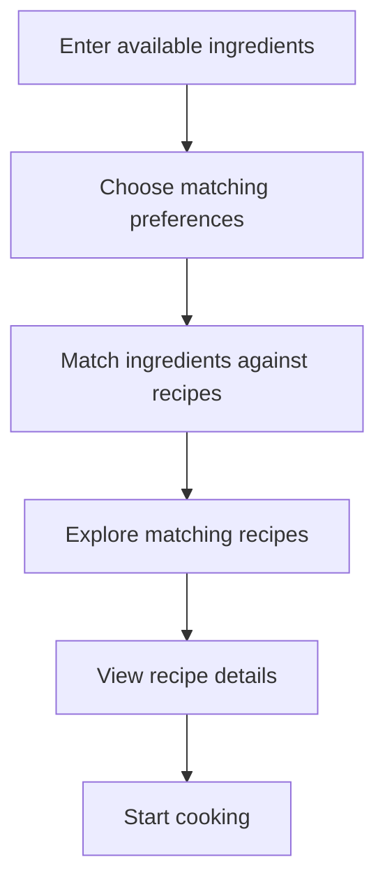

# Nosh Nosh

### Cook with what you've got.

Discover recipes. Save money. Waste less.

## Overview

**Nosh Nosh** is a mobile application project designed to help people discover meals based on ingredients they already have at home. By combining ingredient-based recipe matching with customisable recommendations, the application aims to make everyday cooking simpler, more affordable and more accessible.

Developed as part of the **Universal Credit Launchpad programme**, Nosh Nosh brings together collaborative software development and a practical community-focused challenge.

## The Problem

Deciding what to cook with available ingredients can be challenging, particularly when time, money or food supplies are limited. Traditional recipe searches often require users to find a recipe first and then purchase the necessary ingredients.

Nosh Nosh reverses this process: start with what you have and discover what you can cook.

## Project Objectives

- Simplify meal discovery using available ingredients.
- Help users make better use of their food and reduce unnecessary waste.
- Support affordable cooking, including for people using food banks.
- Enable recipe discovery based on individual preferences and nutritional goals.
- Deliver an intuitive, accessible and functional mobile application.
- Apply professional software engineering and collaborative development practices.

## Planned Features

### Core Functionality — MVP

- **Ingredient selection:** Enter or select ingredients available at home.
- **Recipe matching:** Discover recipes based on selected ingredients.
- **Exact and partial matching:** Find recipes using only available ingredients or requiring a limited number of additional ingredients.
- **Recipe details:** View required ingredients, quantities and step-by-step cooking instructions.
- **User-friendly interface:** Navigate a simple and accessible mobile experience.

### Potential Enhancements

| Feature | Description |
| --- | --- |
| Popular recipes | Discover popular recipes using selected ingredients. |
| Nutritional filters | Find high-protein meals and other recipes aligned with nutritional goals. |
| Dietary preferences | Filter recipes by dietary requirements and preferences. |
| Preparation time | Find meals that fit the user's available time. |
| Budget-friendly recipes | Discover affordable meals, including those using common food bank ingredients. |
| Difficulty levels | Find recipes suited to different cooking abilities. |
| Favourite recipes | Save recipes for future use. |
| Shopping lists | Identify and organise missing ingredients. |

Additional features will be prioritised according to development progress, user feedback and available data. Popularity, nutritional and cost-based recommendations depend on suitable data sources.

## How It Works

The diagram represents the proposed core user journey. Additional filters and sorting options may be introduced as development progresses.

## Target Audience

Nosh Nosh is intended for anyone looking to make better use of the ingredients they have, including:

- Individuals and families looking to save money on food.
- Food bank users with limited ingredient choices.
- Students and beginner cooks.
- Fitness enthusiasts and people with nutritional goals.
- Busy individuals looking for convenient meals.
- Anyone interested in reducing household food waste.

Food banks, charities and community organisations may also benefit from the application.

## Technology Stack

The technology stack is currently under evaluation. Final decisions will be based on the team's experience, project requirements, available resources and development timeframe.

| Component | Technology |
| --- | --- |
| Mobile application | To be confirmed |
| Recipe data source | To be confirmed |
| Data storage | To be confirmed |
| Recipe matching | Rule-based ingredient matching (proposed) |
| Version control | Git & GitHub |
| Project documentation | Google Docs (planned) |

The initial application is intended to work without requiring AI-powered recipe recommendations.

## Development Roadmap

| Phase | Focus |
| --- | --- |
| 1. Planning & Research | Define requirements, research recipe sources and agree on technologies. |
| 2. Design | Establish the application structure, user journeys and interface designs. |
| 3. MVP Development | Implement ingredient selection, recipe matching and recipe details. |
| 4. Feature Expansion | Introduce additional features according to progress and feasibility. |
| 5. Testing & Refinement | Test functionality, collect feedback and resolve issues. |
| 6. Final Presentation | Demonstrate the application and present project outcomes. |

## Getting Started

Nosh Nosh is currently in the planning and early development stage. Installation instructions, system requirements and local development setup will be added once the technology stack and initial implementation are established.

## Team & Collaboration

Nosh Nosh is being developed collaboratively by members of the Launchpad programme. The team combines software engineering and broader engineering experience.

The proposed development workflow includes feature branches, descriptive commits, GitHub Issues, pull requests and peer reviews. Team members and individual responsibilities will be documented once confirmed.

## Project Status

**Early development — planning and requirements definition.**

The application concept has been established. Technical architecture, detailed requirements, recipe data sources and implementation are still being defined. Features described in this README are planned unless explicitly stated otherwise.

## Licence

A software licence has not yet been selected. Licensing and distribution arrangements will be agreed upon by the team and relevant project stakeholders.

---

**Nosh Nosh — Cook with what you've got.**

Developed as part of the Launchpad programme.

